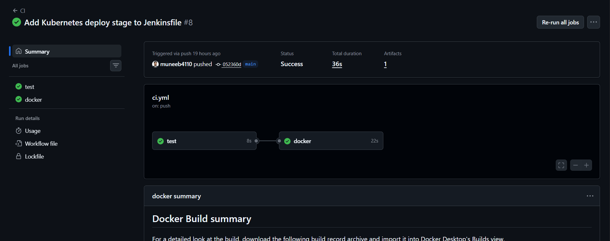
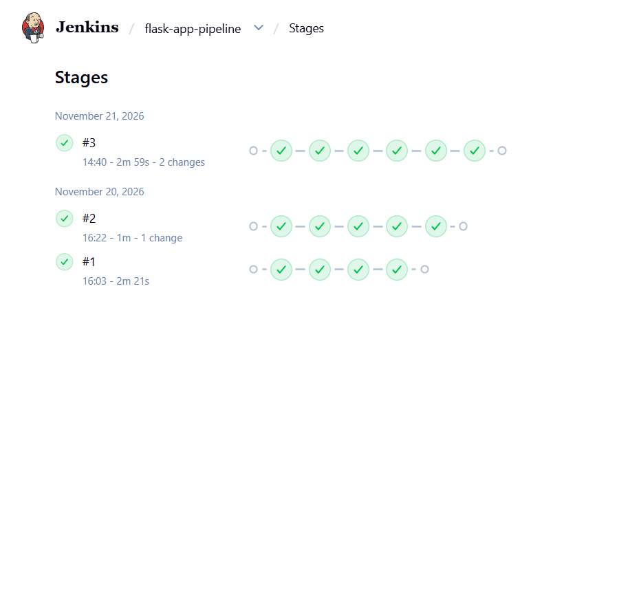
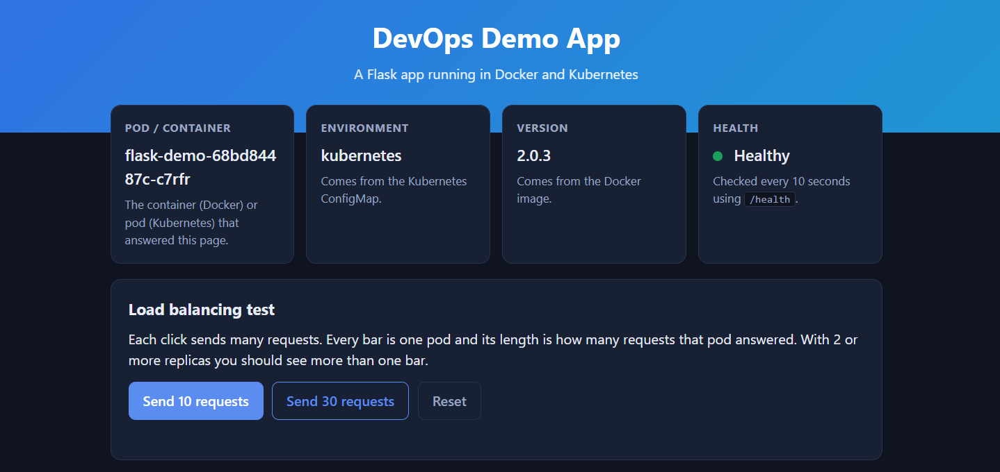

# CI/CD Pipeline Automation (GitHub Actions and Jenkins)


Two CI/CD pipelines for the same small Flask app: one with **GitHub Actions** and one with **Jenkins**. Both run the lint and tests, build a Docker image and push it to GitHub Container Registry (GHCR). The Jenkins pipeline also deploys the new image to a local Kubernetes cluster (minikube) with a rolling update.

The app, Dockerfile and Kubernetes manifests come from my [Docker and Kubernetes project](https://github.com/muneeb4110/docker-kubernetes-flask-app).





## Pipeline overview

```
Developer
   |  git push
   v
GitHub (main)
   |
   +--> GitHub Actions (runs on GitHub)
   |      test job:    flake8 + pytest
   |      docker job:  build image, push to GHCR
   |                   tags: commit SHA, latest   (app version 1.1.<run number>)
   |
   +--> Jenkins (runs on my PC in Docker, started with "Build Now")
          1. Test            flake8 + pytest in a Python venv
          2. Build image     docker build (app version 2.0.<build number>)
          3. Push to GHCR    tag jenkins-<build number>
          4. Deploy          kubectl set image on minikube, wait for the rollout
```

Image: `ghcr.io/muneeb4110/flask-devops-demo`



## What this project shows

- GitHub Actions workflow with a `test` job and a `docker` job that only runs after the tests pass (`needs: test`) and only on pushes (not on pull requests)
- Lint (`flake8`) and tests (`pytest`) on every push
- Docker image build and push to GHCR using the built-in `GITHUB_TOKEN`
- Jenkins running in Docker, configured with a declarative `Jenkinsfile` (pipeline as code) loaded from this repo
- Secrets kept in Jenkins credentials (a GHCR token and a kubeconfig file), never in the code
- Automatic deployment to Kubernetes with `kubectl set image` and `rollout status`
- Every image has a unique tag (commit SHA or build number), so each run is traceable

## Project structure

```
.
├── app.py, templates/, static/, tests/   # Flask app and its tests
├── requirements.txt, requirements-dev.txt
├── Dockerfile                             # App image
├── k8s/                                   # Kubernetes manifests (namespace, configmap, deployment, service)
├── .github/workflows/ci.yml               # GitHub Actions pipeline
├── Jenkinsfile                            # Jenkins pipeline
├── jenkins/
│   ├── Dockerfile                         # Jenkins image with Python, Docker CLI and kubectl
│   └── docker-compose.yml                 # Runs Jenkins
└── docs/screenshots/
```

## 1. GitHub Actions

The workflow is in `.github/workflows/ci.yml` and starts on every push to `main` and on every pull request.

1. `test` job: install dependencies, run `flake8`, run `pytest`
2. `docker` job (only after `test` passes, only on push): log in to GHCR with `GITHUB_TOKEN`, build the image with `APP_VERSION=1.1.<run number>`, and push it with two tags: the commit SHA and `latest`

Run the image from the registry:

```powershell
docker run --rm --pull always -p 5001:5000 ghcr.io/muneeb4110/flask-devops-demo:latest
```

## 2. Jenkins

### Prerequisites (Windows)

- Docker Desktop (WSL 2 backend)
- `kubectl` and `minikube`, with the manifests from `k8s/` applied once:
  ```powershell
  minikube start --driver=docker
  kubectl apply -f k8s/namespace.yaml
  kubectl apply -f k8s/
  ```

### Run Jenkins

```powershell
cd jenkins
docker compose up -d --build
docker exec jenkins cat /var/jenkins_home/secrets/initialAdminPassword
```

Open http://localhost:8080, paste the password, install the suggested plugins and create an admin user. Jenkins data is kept in the `jenkins_home` volume, so jobs and credentials survive restarts.

### Credentials

In Manage Jenkins, Credentials, Global:

| ID | Kind | Content |
| --- | --- | --- |
| `ghcr-credentials` | Username with password | GitHub username and a personal access token (classic) with the `write:packages` scope |
| `kubeconfig` | Secret file | kubeconfig for minikube (created below) |

Create the kubeconfig file. It stays in the home folder, outside the repo, because it contains admin keys for the cluster:

```powershell
kubectl config view --flatten --minify --context=minikube | Set-Content -Encoding ascii $env:USERPROFILE\jenkins-kubeconfig.yaml
(Get-Content $env:USERPROFILE\jenkins-kubeconfig.yaml) -replace 'server: https://127.0.0.1:\d+', 'server: https://192.168.49.2:8443' | Set-Content -Encoding ascii $env:USERPROFILE\jenkins-kubeconfig.yaml
```

The second command replaces `127.0.0.1` (which only works on the host) with the minikube container address, which Jenkins can reach.

### Connect Jenkins to the minikube network

Start minikube first, then run:

```powershell
docker network connect --ip 192.168.49.100 minikube jenkins
```

### Create the pipeline job

1. New Item, name `flask-app-pipeline`, type Pipeline
2. Definition: Pipeline script from SCM, SCM: Git
3. Repository URL: `https://github.com/muneeb4110/cicd-pipeline-jenkins-github-actions.git`, branch `*/main`, script path `Jenkinsfile`
4. Save, then Build Now

Builds are started manually. A webhook would need a public URL for Jenkins, which a local setup does not have.

### Check the deployment

```powershell
kubectl -n devops-demo get pods
kubectl -n devops-demo get deployment flask-demo -o jsonpath="{.spec.template.spec.containers[0].image}"
minikube service flask-demo -n devops-demo
```

The image is `ghcr.io/muneeb4110/flask-devops-demo:jenkins-<build number>` and the page shows version `2.0.<build number>`.

## Security notes

- The Jenkins container mounts the Docker socket, which gives it full control of the host Docker. That is fine for a local lab but not for production.
- The GHCR token has only the `write:packages` scope and lives in Jenkins credentials. `withCredentials` hides its value in the build log.
- The kubeconfig file contains cluster admin keys. It is stored outside the repo and uploaded to Jenkins as a secret file.
- No secrets are committed to this repo.

## Troubleshooting

Problems I hit while building this, and how I fixed them:

| Problem | Cause and fix |
| --- | --- |
| `docker compose build` for Jenkins ends with `error reading from server: EOF` | The Docker engine stopped in the middle of the build, most likely because of memory pressure (minikube was using several GB). Stop minikube with `minikube stop`, build Jenkins, then start minikube again. |
| `minikube start` fails with `Address already in use` | minikube needs the fixed address `192.168.49.2`. Jenkins had been connected to the `minikube` network while minikube was stopped and took that address. Run `docker network disconnect minikube jenkins`, start minikube, then connect Jenkins again with `--ip 192.168.49.100`. |
| Jenkins `kubectl` says `connection refused` on `192.168.49.2:8443` | The API server was not running, or Jenkins itself held that address (see the row above). Start minikube and reconnect Jenkins with a different fixed address. |
| `container jenkins is not running` after a restart | Containers do not start by themselves after Docker restarts. Run `docker start jenkins`. |
| `minikube` is not recognized | The terminal was opened before the install. Open a new terminal or restart VS Code. |

## What I learned

- **CI and CD.** Continuous integration runs the lint, tests and build on every push, so a broken change is found right away. Continuous delivery then ships the result. GitHub Actions (YAML, hosted by GitHub) and Jenkins (a `Jenkinsfile`, hosted by me) do the same job with different tools.
- **Gating.** With `needs: test`, the image is built only when the tests pass, so a bad commit never reaches the registry.
- **Secrets.** Tokens and kubeconfig files are kept in Jenkins credentials or GitHub's `GITHUB_TOKEN`, never in the code. The token has the smallest scope it needs (`write:packages`), and `withCredentials` hides it in the logs.
- **Image tags.** `latest` moves, but a commit SHA or build number always points to one exact build. Deploying a unique tag also makes Kubernetes start a rolling update, and it makes every deployment traceable.
- **Docker socket.** Mounting the Docker socket lets Jenkins build images on the host Docker, but it also gives Jenkins full control of the host. That is a trade-off I would avoid in production.
- **Docker networking.** Containers on a user-defined network get addresses from the same pool. A container that needs a fixed address (minikube) can be blocked if another container takes it first, so the order of starting things matters and fixed addresses help.
- **Debugging.** I read the exact error text first (`Address already in use`, `connection refused`, `EOF`), then worked out which component it came from, instead of guessing.
